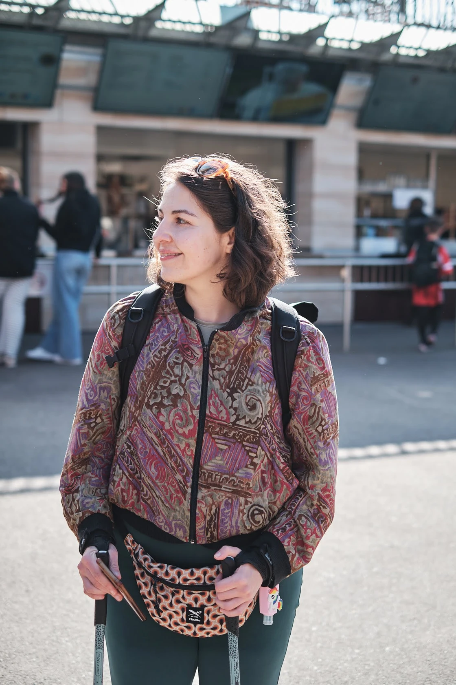

I’m a freelance tour guide, moderator, and Turkish teacher. Get in touch to discuss a guided tour, an event, or Turkish lessons.

[Get in touch](/#contact-section)

## Academic background

I am currently working as a Research Assistant in Datenbanken und Informationssysteme group at Humboldt-Universität zu Berlin. I am also a member of a PhD school on service-oriented Architectures for the Integration of Software-based Processes, exemplified by Health Care Systems and Medical Technology (SOAMED). My research focuses specifically on privacy in clinical business process models.

### Biographical highlights

PhD in Computer Engineering, Humboldt-Universität zu Berlin, July 2016 - present

M.Sc. in Computer Engineering, Middle East Technical University, Jan 2013 - Dec 2015

Title of Master's thesis: *Design And Development of Medical Recommendation System for Home Care Service for Geriatrics* - [Abstract](https://user.ceng.metu.edu.tr/~sirem/abstract.pdf)

B.Sc. in Computer Engineering, Bilkent University, 2013

### Areas of interest

Database Systems, Business Process Modeling, Privacy, Clinical Informatics, Data Mining, Machine Learning
